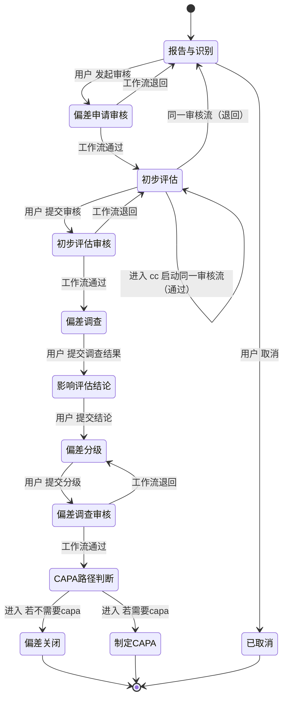

# 偏差管理_lyl_aa（deviationmanagement__c）生命周期分析

> 对象：**偏差管理_lyl_aa**（`deviationmanagement__c`）  
> 对象 ID：`3a209e1c-ba3f-82c6-5c38-ab4aa5730b23`  
> 生命周期：**偏差管理_lyl_aa生命周期**  
> 生命周期 ID：`3a209e1c-ba3f-bafc-6881-5e7e5b5b80ad`  
> 环境：`https://standard-val.aksoegmp.com`  
> 读取时间：2026-11-12  
> 数据口径：只读；状态以 `Status/GetList` 的 `isEnabled` 为准；动作类型以 `GetById` 的 `configs` 为准。
>
> 流程图：[deviationmanagement__c-lifecycle.drawio](deviationmanagement__c-lifecycle.drawio) ｜ [PNG 预览](deviationmanagement__c-lifecycle.png)
>
> 画法：竖向排列；状态用「生命周期状态」，用户动作用「用户动作」，审批流任务用「用户任务」，分支用「判断」；黑色箭头表示流转方向。进入动作和条件不展开。
>
> 模块展示：[便笺本模块展示.drawio](便笺本模块展示.drawio) ｜ [PNG](便笺本模块展示.png)

## 1. 概览

| 项目 | 数量 / 内容 |
|---|---|
| 生命周期状态 | **14 个**（全部启用） |
| 动作总数 | **15 个**（用户动作 7 个，进入动作 8 个） |
| 有动作的状态 | 10 个 |
| 状态跳转（behaviorType=9） | **8 条**（另有 6 条工作流动作边，见 4.1/4.2） |
| 关联工作流 | **3 条**，全部为审批流 |
| 生命周期进入条件 | **未配置**（`StatusEnterRule/GetList` 返回空数组） |
| 停用状态 | 0 个 |

## 2. 生命周期状态

| sort | 状态名称 | 状态 code | 启用 | 进入动作 | 用户动作 |
|---:|---|---|---:|---:|---:|
| 0 | 报告与识别 | `init_status__c` | 是 | 0 | 2 |
| 1 | 偏差申请审核 | `Deviation_Application_Review__c` | 是 | 1 | 0 |
| 2 | 初步评估 | `Preliminary_Assessment__c` | 是 | 2 | 2 |
| 3 | 已取消 | `Cancelled__c` | 是 | 0 | 0 |
| 4 | 初步评估审核 | `PreliminaryAssessmentReview__c` | 是 | 1 | 0 |
| 5 | 偏差调查 | `Deviation_Investigation__c` | 是 | 0 | 1 |
| 6 | 影响评估结论 | `Impact_Assessment_Conclusion__c` | 是 | 0 | 1 |
| 7 | 偏差分级 | `Deviation_Classification__c` | 是 | 0 | 1 |
| 8 | 偏差调查审核 | `Deviation_Investigation_Review__c` | 是 | 1 | 0 |
| 9 | 偏差关闭 | `Bias_Off__c` | 是 | 1 | 0 |
| 10 | 关闭 | `complete_status__c` | 是 | 0 | 0 |
| 11 | 等待行动项完成 | `Waiting_for_action_item_to_complete__c` | 是 | 0 | 0 |
| 12 | CAPA路径判断 | `CAPA_Path_Determination__c` | 是 | 2 | 0 |
| 13 | 制定CAPA | `Develop_CAPA__c` | 是 | 0 | 0 |

## 3. 动作明细

| 状态 | 类型 | 动作名称 | 动作 code | behaviorType | 触发效果 |
|---|---|---|---|---|---|
| 报告与识别 | 用户动作 | 发起审核 | `Initiate_Review__c` | 9 | 修改状态 → 偏差申请审核 |
| 报告与识别 | 用户动作 | 取消 | `Cancel__c` | 9 | 修改状态 → 已取消 |
| 偏差申请审核 | 进入动作 | 进入审核工作流 | `ee12fb9ba06a87f16c5a43a209e655c4d` | 7 | 发起工作流《偏差申请审核流程_lyl_aa》 |
| 初步评估 | 用户动作 | 提交审核 | `Submit_for_Review__c` | 9 | 修改状态 → 初步评估审核 |
| 初步评估 | 用户动作 | sdfsdf | `sdfsdf__c` | 48 | 启动检查表 339d9a56-2b46-4e39-a0da-b837fd5ed808 |
| 初步评估 | 进入动作 | 启动检查表 | `e215d6fdc3bc913e47fdc3a20a0d0b5f1` | 10 | 启动检查表 339d9a56-2b46-4e39-a0da-b837fd5ed808 |
| 初步评估 | 进入动作 | cc | `e502b33d6e54370c8aafe3a2132e22dae` | 7 | 发起工作流《偏差申请审核流程_lyl_aa》 |
| 初步评估审核 | 进入动作 | 开启初步评估审核工作流 | `ef850796d72fe747e42123a209ed18d0b` | 7 | 发起工作流《初步评估审核流程_lyl_aa》 |
| 偏差调查 | 用户动作 | 提交偏差调查结果 | `Submit_Impact_Assessment__c` | 9 | 修改状态 → 影响评估结论 |
| 影响评估结论 | 用户动作 | 提交影响评估结论 | `Submit_Grading__c` | 9 | 修改状态 → 偏差分级 |
| 偏差分级 | 用户动作 | 提交偏差调查分级结果 | `Submit_Investigation_Review_Results__c` | 9 | 修改状态 → 偏差调查审核 |
| 偏差调查审核 | 进入动作 | 进入审核工作流 | `e8f77aad8a8a897d1e6f13a209f7c06ff` | 7 | 发起工作流《偏差调查审核流程_lyl_aa》 |
| 偏差关闭 | 进入动作 | 记录偏差关闭时间 | `e235ad336526eb1a601893a209f7f6b26` | 5 | 修改字段「关闭日期」= Now() |
| CAPA路径判断 | 进入动作 | 若需要capa | `e6dbff2e52067a9dd91513a209fb11f7f` | 9 | 修改状态 → 制定CAPA |
| CAPA路径判断 | 进入动作 | 若不需要capa | `e4823a92643acb7f232ae3a209fb1ea20` | 9 | 修改状态 → 偏差关闭 |

## 4. 状态跳转（由 behaviorType=9 的配置得出）

> 这里列的是动作配置里的目标状态，不等于平台一定自动跳转：用户动作需要点击，进入动作在进入状态时执行。

| 从 | 到 | 触发方式 | 动作 |
|---|---|---|---|
| 报告与识别 | 偏差申请审核 | 用户动作 | 发起审核 |
| 报告与识别 | 已取消 | 用户动作 | 取消 |
| 初步评估 | 初步评估审核 | 用户动作 | 提交审核 |
| 偏差调查 | 影响评估结论 | 用户动作 | 提交偏差调查结果 |
| 影响评估结论 | 偏差分级 | 用户动作 | 提交影响评估结论 |
| 偏差分级 | 偏差调查审核 | 用户动作 | 提交偏差调查分级结果 |
| CAPA路径判断 | 制定CAPA | 进入动作 | 若需要capa |
| CAPA路径判断 | 偏差关闭 | 进入动作 | 若不需要capa |

### 4.1 工作流动作节点带来的跳转

工作流不是独立节点，而是挂在上游状态上的“宏动作”：进入状态 → 启动工作流 → 审批通过/退回 → 工作流里的动作节点改状态。

| 工作流 | 启动于 | 审批结果 | 动作节点 | 目标状态 |
|---|---|---|---|---|
| 偏差申请审核流程_lyl_aa | 偏差申请审核（进入动作） | 审核通过 | 修改状态 | **初步评估** |
| 偏差申请审核流程_lyl_aa | 偏差申请审核（进入动作） | 审核退回 | 修改状态 | **报告与识别** |
| 初步评估审核流程_lyl_aa | 初步评估审核（进入动作） | 初步评估通过 | 修改状态 | **偏差调查** |
| 初步评估审核流程_lyl_aa | 初步评估审核（进入动作） | 初步评估退回 | 修改状态 | **初步评估** |
| 偏差调查审核流程_lyl_aa | 偏差调查审核（进入动作） | 审核通过 | 修改状态 | **CAPA路径判断** |
| 偏差调查审核流程_lyl_aa | 偏差调查审核（进入动作） | 审核退回 | 修改状态 | **偏差分级** |

### 4.2 完整流转（状态动作 + 工作流动作）

| # | 从 | 到 | 触发 | 条件 / 说明 |
|---:|---|---|---|---|
| 1 | 报告与识别 | 偏差申请审核 | 用户动作“发起审核” | 手动提交 |
| 2 | 报告与识别 | 已取消 | 用户动作“取消” | 终止 |
| 3 | 偏差申请审核 | 初步评估 | 偏差申请审核流程 | 审批通过 |
| 4 | 偏差申请审核 | 报告与识别 | 偏差申请审核流程 | 审批退回 |
| 5 | 初步评估 | 初步评估审核 | 用户动作“提交审核” | 手动提交 |
| 6 | 初步评估 | 初步评估 | 进入动作 `cc` 启动偏差申请审核流程 | 该流程“通过”又回到初步评估，**可能自环** |
| 7 | 初步评估 | 报告与识别 | 同上 | 该流程“退回” |
| 8 | 初步评估审核 | 偏差调查 | 初步评估审核流程 | 初步评估通过 |
| 9 | 初步评估审核 | 初步评估 | 初步评估审核流程 | 初步评估退回 |
| 10 | 偏差调查 | 影响评估结论 | 用户动作“提交偏差调查结果” | 手动提交 |
| 11 | 影响评估结论 | 偏差分级 | 用户动作“提交影响评估结论” | 手动提交 |
| 12 | 偏差分级 | 偏差调查审核 | 用户动作“提交偏差调查分级结果” | 手动提交 |
| 13 | 偏差调查审核 | CAPA路径判断 | 偏差调查审核流程 | 审核通过 |
| 14 | 偏差调查审核 | 偏差分级 | 偏差调查审核流程 | 审核退回 |
| 15 | CAPA路径判断 | 制定CAPA | 进入动作“若需要capa” | `behaviorType=9`，无 condition |
| 16 | CAPA路径判断 | 偏差关闭 | 进入动作“若不需要capa” | `behaviorType=9`，无 condition |

## 5. 关联工作流

### 5.1 偏差申请审核流程_lyl_aa（`Deviation_Application_Review_Process__c`）

| 项目 | 值 |
|---|---|
| workflowBasicId | `3a209e4c-b901-66f1-839b-6dfb8cc9922b` |
| workflowConfigId | `980f2a56-0070-3a45-9b12-3a209e64b635` |
| 状态 | `20`（20=已发布） |
| isAllowTrigger | `true` |
| 版本 | `4` |

| sort | 步骤 | 类型 | isEnable |
|---:|---|---|---:|
| 1 | 开始 | 10 | true |
| 2 | 偏差上报审核 | 30 | true |
| 33 | 判断审批结果 | 70 | true |
| 35 | 审核通过 | 90 | true |
| 94 | 审核退回 | 90 | true |
| 100185 | 结束 | 20 | true |

### 5.2 初步评估审核流程_lyl_aa（`Preliminary_Evaluation_and_Review_Process__c`）

| 项目 | 值 |
|---|---|
| workflowBasicId | `3a209ec5-4416-2ed4-e6f8-0a5dfd44a35e` |
| workflowConfigId | `e64c9f7a-fecf-cbc5-6ebb-3a209ed774e7` |
| 状态 | `20`（20=已发布） |
| isAllowTrigger | `true` |
| 版本 | `2` |

| sort | 步骤 | 类型 | isEnable |
|---:|---|---|---:|
| 1 | 开始 | 10 | true |
| 2 | 初步评估审核 | 30 | true |
| 33 | 初步评估审核判断 | 70 | true |
| 35 | 初步评估退回 | 90 | true |
| 94 | 初步评估通过 | 90 | true |
| 100185 | 结束 | 20 | true |

### 5.3 偏差调查审核流程_lyl_aa（`Deviation_Investigation_Review_Process_lyl_aa__c`）

| 项目 | 值 |
|---|---|
| workflowBasicId | `3a209f74-7539-d3f1-f373-b19fcd99ba67` |
| workflowConfigId | `178542c0-61fa-0898-6dc9-3a209facb333` |
| 状态 | `20`（20=已发布） |
| isAllowTrigger | `true` |
| 版本 | `2` |

| 顺序 | 步骤 | 类型 | isEnable |
|---:|---|---|---:|
| 1 | 开始 | 10 | true |
| 2 | 偏差调查审核 | 30 | true |
| 3 | 审批结果判断 | 70 | true |
| 4 | 审核退回 | 90 | true |
| 5 | 审核通过 | 90 | true |
| 6 | 结束 | 20 | true |

## 6. 生命周期进入条件

| 项目 | 结果 |
|---|---|
| 接口 | `GET /api/config/lifecycle/StatusEnterRule/GetList?lifecycleId=3a209e1c-ba3f-bafc-6881-5e7e5b5b80ad` |
| 返回 | `data: []` |
| 结论 | 当前生命周期**没有配置进入条件** |

## 7. 异常与待确认

1. **`初步评估` 的进入动作 `cc` 启动 `偏差申请审核流程`，而该流程“审核通过”又改回 `初步评估`**：这会把状态重新进入 `初步评估`，再次触发同一条进入动作，形成**自环/重复审批**。这是当前最需要优先确认的配置风险；如果平台对“同一状态重入”不重复执行进入动作，则只产生一次回环，否则可能循环。
2. **`CAPA路径判断` 有两个进入动作，都是 `behaviorType=9`（改状态），且 `conditionStr=null`**：一个去“制定CAPA”，一个去“偏差关闭”。两者都没有条件，配置上可能同时执行，最终状态取决于执行顺序；需要在页面上确认是否有未返回的条件/排序，或拆分条件。
3. **`初步评估` 还有第二个进入动作“启动检查表”**：它与 `cc` 同时挂在该状态，需确认是否都应执行、顺序如何。
4. **`初步评估` 的用户动作 `sdfsdf`（`sdfsdf__c`）** 是“启动检查表”（48），名称像测试数据；上线前应改名或删除。
5. **`偏差申请审核流程` 被两个进入动作引用**：`偏差申请审核` 和 `初步评估` 都会发起同一条流程，需确认是否符合业务预期。
6. **`已取消` 没有回到主流程的动作**：`取消` 只进不出（除非工作流/页面另有入口），需确认是否为终止态。
7. **`关闭` 状态没有任何动作/入边**：`CAPA路径判断` 的“不需要 CAPA”去的是“偏差关闭”，不是“关闭”；`关闭` 是否为保留状态需确认。
8. **`制定CAPA`、`偏差关闭`、`等待行动项完成` 没有读到出口动作**：可能是页面按钮/工作流之外的入口，需补配置或说明。

## 8. 阅读边界

- 未读取工作流内部审批人、判断条件、审批按钮签名配置；只列了步骤骨架。
- 未读取状态流转关系接口（`StatusRelation`/`Flowchart` 读接口不可用），本文的跳转只来自 `behaviorType=9` 的动作配置。
- `Status/GetList` 当前返回分页对象 `{count, datas}`，不是裸数组；脚本已按 `data.datas` 兼容。
- 用户动作 `GetById` 对部分动作返回 `data:null`，本文回落到 list 的 `configs`；进入动作必须用 `GetById`。

## 9. 数据来源

| 用途 | 接口 |
|---|---|
| 对象 | `GET /api/openapi/v1.0/BasicObject/deviationmanagement__c` |
| 状态 | `GET /api/config/lifecycle/Status/GetList`（按 lifecycleId 过滤） |
| 用户动作 | `GET /api/config/lifecycle/UserAction/GetListByStatusId` + `GetById` |
| 进入动作 | `GET /api/config/lifecycle/EnterAction/GetListByStatusId` + `GetById` |
| 进入条件 | `GET /api/config/lifecycle/StatusEnterRule/GetList` |
| 工作流 | `POST /api/platform/Workflow/GetWorkflowBasicPageViewList` + `GetWorkflowBasic` + `GetWorkflowSteps` |

> 动作实际执行结果仍以平台运行记录为准。
