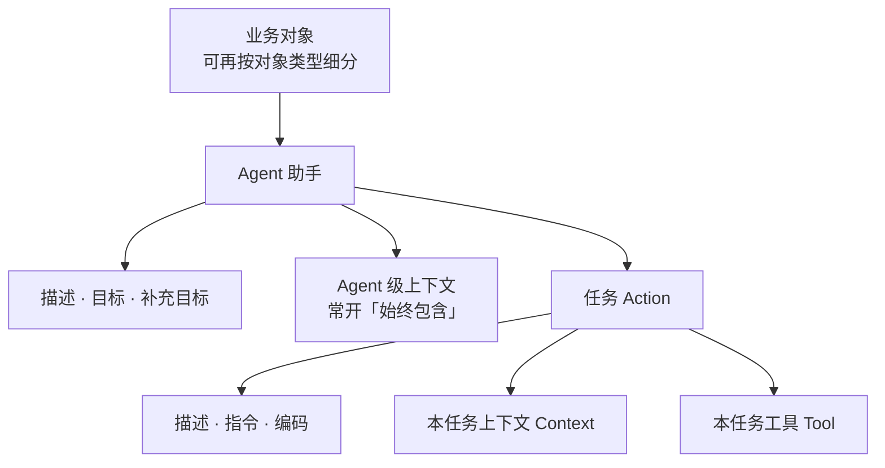
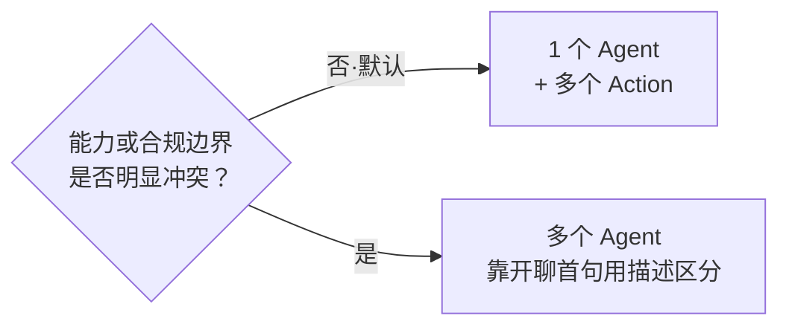
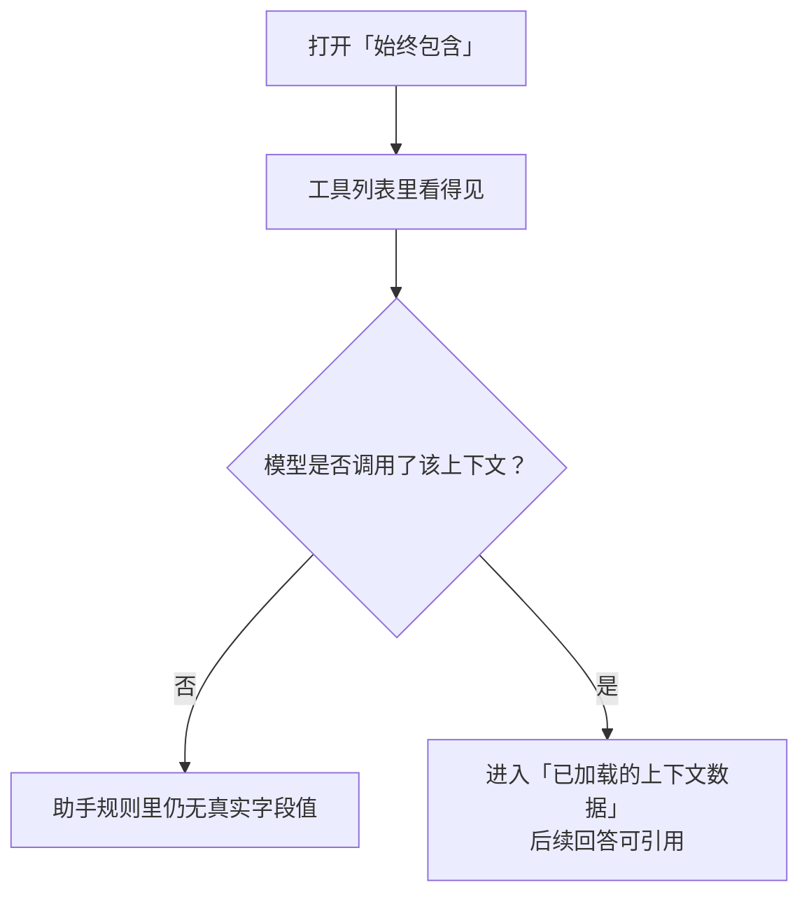
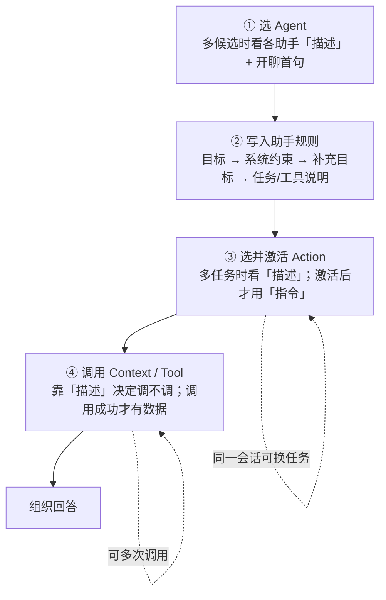

面向**配置人员**：说明 AI 助手对话里，各配置字段**会不会被模型用到、什么时候用到**，以及怎么写才有效。  
不必看程序代码。文中字段名与配置台保持一致（如「始终包含」）。

本文以制药 GxP 场景下的**偏差（Deviation）记录助手**为完整案例。也可先读第 7 章案例，再回看前面原则。

---

## 1\. 我在配什么（先认地图）

### 1.1 配置入口与层级

在管理端 **AI 配置** 中维护（常见路径：AI Agent / 上下文 / 任务 / 工具相关菜单）。挂载关系如下：

用户在某条业务记录详情页打开 AI 助手时：系统按\*\*当前对象（及对象类型）\*\*找到候选 Agent，再进入对话。

### 1.2 界面字段名对照

| 配置台字段 | 一句话 |
|---------------|---------|
| 名称 | 给人看的名字；描述为空时，选型可能拿名称凑数（区分度通常不够） |
| 编码 | 会出现在模型看到的「可选任务」等列表里（形如 `编码：描述`），请保持可读、稳定 |
| 描述 | **选型文案**：该不该选这个助手 / 任务 / 该不该调这个上下文或工具 |
| 目标 | **执行文案**：助手角色、总职责、合规边界（配置台一般为必填） |
| 补充目标 | 写在系统通用规则之后的额外说明；**默认留空** |
| 指令 | **执行文案**：任务怎么做（步骤、先调什么、禁止什么） |
| 始终包含 | 控制上下文是否一直「看得见」；**不等于已经带上数据** |
| 输入参数 / 输出参数（工具） | 帮助模型拼参数、理解返回；输出参数不是对真实返回的强制校验 |

### 1.3 怎么拆：默认一助手多任务

| 做法 | 适用 |
|------|------|
| **默认**：1 个 Agent \+ 多个 Action | 同一业务对象、同一合规边界，只是用户意图不同（查概况 / 查关联 / 查历史） |
| **再拆多个 Agent** | 能力或合规边界明显冲突（例如「只查询」vs「起草须人工审核的建议」），需要靠用户**开聊首句**分开 |

不要为「看起来更专业」过度拆 Agent；拆多了，选型压力全落在各 Agent 的**描述**上。

---

## 2\. 两条铁律

### 2.1 选型文案 vs 执行文案

| 类型 | 典型字段 | 作用 |
|------|------------|------|
| **选型文案** | Agent 描述、Action 描述、Context/Tool 描述 | 告诉模型「该不该选我 / 该不该调我」 |
| **执行文案** | Agent 目标、Action 指令 | 选中之后告诉模型「你是谁、怎么做、边界在哪」 |

常见误区：
- 把长篇执行规则写进**描述** → 选型时噪音大，执行时又缺步骤
- 把「何时选用」写进**目标/指令** → 多候选时仍可能选错
- 以为配了 Context 描述或打开「始终包含」，数据就会自动出现在回答里 → **不会**；必须等模型**调用**该上下文后，数据才进入「已加载的上下文数据」

### 2.2 可见 ≠ 已加载

「始终包含 = 是」只表示：该上下文作为可用工具**一直能被看见**（便于随时调用）。   **没有调用过**，助手规则里就不会出现真实字段值。

---

## 3\. 单/多候选：决定「描述」有没有用

### 3.1 同对象上的 Agent 数量（含对象类型）

同一业务对象上可挂多个 Agent；若配置了**对象类型**，系统会先按当前记录的对象类型收窄候选，再在剩余候选里选型。

| 场景 | Agent「描述」 | Agent「目标」 |
|------|-----------------|-----------------|
| **只有 1 个**候选 Agent | 几乎不参与选型 | **每轮对话**都会写入助手规则，约束角色与职责 |
| **多个**候选 Agent | **会**参与选型：对照用户**开聊首句**选最匹配的 Agent | **不参与**选型；选中后才写入助手规则 |

重要时机：
- Agent 一般在**会话开始、看用户首句**时选定；同一会话中途改口（例如从查询改成起草 CAPA），通常**不会**自动换 Agent，需要**新开对话**。
- 想靠改「目标」纠正选错助手 → **无效**；应改各 Agent 的**描述**对比度。

配置原则：
- **描述** = 何时选这个助手（建议 1～3 句：做什么 \+ 不做什么）
- **目标** = 选中后的角色、总职责与合规边界（可较长；界面必填，请写清业务边界）
- 即便当前只有一个 Agent，仍建议描述留一句意图摘要，方便以后加第二个 Agent

**描述句式（可直接套）**：
> 解答 / 协助〔业务范围〕。不负责〔明确排除的能力〕。   

### 3.2 同一 Agent 下的 Action 数量

| 场景 | Action「描述」 | Action「指令」 |
|------|------------------|------------------|
| **多个** Action | 进入「可选任务」列表（展示为 `编码：描述`），供模型先选任务 | 选中并激活后，才作为当前任务说明写入助手规则 |
| **只有 1 个** Action | **不**进入可选任务列表（可当给人看的备注） | **直接**写入助手规则，作为当前任务说明 |
| **0 个** Action | — | —（偏纯对话；仍可能有始终可见的上下文工具） |

配置原则：
- **描述** = 什么用户意图该选这个任务（短、互不撞车）
- **指令** = 选中后怎么做（先调什么上下文/工具、如何组织答案、禁止什么）
- **编码**请用稳定、可读的业务码（模型与排错都会看到）

同一会话内，数据不足时模型可能**切换到其他任务**（仍受系统次数护栏限制）。因此：
- 需要跨任务都能调用的主数据类上下文 → 打开「始终包含」
- 记住：换任务后常驻上下文仍是「看得见」，**不等于**已经加载过数据

---

## 4\. 一次对话里字段何时生效

只记时机，不要求理解实现细节。总览如下：

说明：Agent 一般只在开聊时选定；中途换意图（如查询改起草）通常需**新开对话**。任务则可在同一会话内切换（受次数护栏限制）。

### ① 选择 Agent（多个候选时）
- 用各 Agent 的**描述**（空则用**名称**凑合，区分度通常不够）
- **不用**目标、补充目标
- 依据主要是用户**开聊首句**

### ② 写入助手规则（每轮都会）

大致顺序：
1. **目标**（界面必填；若运行时为空，系统会用一段默认助手角色句——业务场景请自己写目标）
2. **系统固定的核心约束**（禁止编造、数据不足时如何处理等——配置侧不必再抄）
3. **补充目标**（有内容才追加；**默认留空**）
4. 多个 Action：列出可选任务（各 Action 的**编码 \+ 描述**）
5. 单个 Action：写入该 Action **指令**
6. 若已有上下文被成功调用过：写入「已加载的上下文数据」
7. 列出当前**可用工具**（含 Context 与 Tool 的**描述**）
8. **系统固定的输出规范**（Markdown、注明来源等——配置侧不必再抄）

### ③ 选择并激活 Action（多个 Action 时）
- 模型根据可选任务里的 **Action 描述**（及编码）选择任务
- 激活成功后，该 Action 的**指令**才作为执行说明写入
- 同时带上该 Action 绑定的工具与上下文（见「始终包含」）
- 之后仍可能切换到其他 Action；「始终包含」的上下文会继续留在可见工具里

### ④ 调用 Context / Tool
- **描述**：决定要不要调
- **输入参数**（Tool）：决定怎么把参数拼对
- **输出参数**（Tool）：提示返回大概长什么样（帮助理解；**不是**硬校验）
- Context 调用成功后，返回内容进入「已加载的上下文数据」，供后续回答引用

---

## 5\. 系统已有内容：配置时不要重复写

系统会自动加入两类通用规则：
1. **核心约束**：只能基于已加载上下文与工具结果回答；禁止臆造数值、日期、人员、编号；数据不足时应切换任务或明确说明缺什么
2. **输出规范**：使用 Markdown；对比用表格；引用时注明来源字段或记录标识

**配置原则**：目标与指令只写**本业务差异化**内容（例如「不得代替质量人员做偏差分级或签字结论」），不要再抄「禁止幻觉」「请用 Markdown」。

业务边界可以在目标里强调（如「不得签字结论」）；与系统原文完全重复的句子请删掉。

---

## 6\. 字段说明与配置原则（速查）

### 6.1 Agent

| 字段 | 会否被采用 | 何时采用 | 怎么写 |
|------|---------------|------------|---------|
| 名称 | 条件采用 | 描述为空时的选型后备 | 清晰可读；不要指望单靠名称区分多助手 |
| 编码 | 采用（展示） | 选型列表等场景会暴露给模型 | 稳定、可读 |
| 描述 | 条件采用 | 多个候选 Agent 时，对照**开聊首句**选型 | 1～3 句：做什么 \+ 不做什么 |
| 目标 | 采用 | 选中后每轮助手规则开头 | 角色 \+ 总职责 \+ 合规边界（界面必填） |
| 补充目标 | 条件采用 | 核心约束之后追加 | **默认留空**（见下） |

**补充目标何时才填（例外）**：
- 短期活动/试点的临时规则，不想改动长期「目标」正文时
- 分期上线：先上查询、后上起草，需要临时加一句能力边界时

即便填写，也不要重复系统核心约束与输出规范；日常配置请把内容写进**目标**，补充目标留空。

### 6.2 Agent 上下文（Context）

| 字段 | 会否被采用 | 何时采用 | 怎么写 |
|------|---------------|------------|---------|
| 描述 | 采用 | 该上下文作为可用工具出现时 | 写「提供什么信息 / 何时应调用」；不要当数据正文 |
| 始终包含 | 影响出现时机 | 见下表 | 控制是否一直看得见，**不等于自动带数据** |

**始终包含**：

| 取值 | 效果 |
|------|------|
| 是 | Agent 级：对话一开始就出现在可用工具里；Action 级：该任务激活后会留在常驻可见集合，切换任务仍可见 |
| 否 | 只在所属 Action 激活后出现；未激活时模型看不到 |

### 6.3 Agent 任务（Action）

| 字段 | 会否被采用 | 何时采用 | 怎么写 |
|------|---------------|------------|---------|
| 编码 | 采用（展示） | 可选任务列表为 `编码：描述` | 稳定、可读 |
| 描述 | 条件采用 | 多个 Action 时进入可选任务列表 | 短；只写「什么用户意图该选我」 |
| 指令 | 采用 | 单 Action 直接写入；多 Action 在激活后写入 | 步骤：先调什么、如何组织答案、禁止什么 |

单 Action 时：描述不进可选列表，可当**给人看的备注**；精力放在指令上。

### 6.4 工具（Tool）

| 字段 | 会否被采用 | 何时采用 | 怎么写 |
|------|---------------|------------|---------|
| 描述 | 采用 | 工具出现在可用集合时 | 写「何时用、干什么」 |
| 输入参数 | 采用 | 模型拼装调用参数时 | 必填项、含义、取值说明写清楚 |
| 输出参数 | 条件采用 | 提示返回结构时 | 返回结构稳定再维护；不稳定可留空，避免误导 |

输出参数（有的界面也称「响应结构」）只是返回形态说明，系统不会按它强制校验工具真实返回是否一致。

---

## 7\. 完整案例：偏差对象上的 GxP AI 助手
> 本案例故意拆成两个 Agent，用来演示「开聊首句靠描述选型」。日常若边界不冲突，优先「1 个查询助手 \+ 多个任务」。   

### 7.1 业务背景

企业在偏差记录详情页提供 AI 助手。同对象配置了 **两个 Agent**：
1. **偏差查询助手**：查状态、关联批/物料、相似历史偏差
2. **CAPA 起草建议助手**：基于当前偏差给出 CAPA 建议草案（须人工审核）

---

### 7.2 Agent 配置示例

#### Agent A：偏差查询助手

| 字段 | 配置示例 |
|------|------------|
| 描述 | 解答当前偏差记录的内容、状态、关联批/物料，以及历史相似偏差检索。不负责起草 CAPA。 |
| 目标 | 你是制药 GxP 场景下的偏差记录助手。仅基于系统已加载的偏差数据与工具返回结果回答；涉及批号、物料、日期、人员、结论时必须能对应到具体字段或工具结果，不得臆测。不代替质量人员做偏差分级、放行或签字结论。 |
| 补充目标 | （空） |

#### Agent B：CAPA 起草建议助手

| 字段 | 配置示例 |
|------|------------|
| 描述 | 基于当前偏差，协助起草 CAPA 的问题描述、根因与纠正/预防措施建议草案，供质量人员编辑。 |
| 目标 | 你是 CAPA 起草辅助助手。输出仅为建议草案，须标注「需人工审核」；不得声称已批准、已生效或已关闭。措施建议须能追溯到已加载的偏差事实；信息不足时明确列出待补充项，不得编造根因。 |
| 补充目标 | （空） |

**为何这样写**：
- 两条**描述**一眼可区分「查询」与「起草」，选型靠描述与开聊首句
- **目标**承担 GxP 边界（不签字、不编造、草案须审核）
- **补充目标**留空，避免与目标抢注意力

---

### 7.3 偏差查询助手：三个 Action

#### Action 1：偏差概况解读

| 字段 | 配置示例 |
|------|------------|
| 描述 | 解读当前偏差的基本信息、描述、状态、分级与关键时间节点。 |
| 指令 | 先调用「当前偏差主数据」上下文获取字段。按「概况 → 关键时间 → 状态/分级 → 尚缺信息」组织回答。不得补充系统中未出现的批号、人员或结论。 |

#### Action 2：关联批与物料

| 字段 | 配置示例 |
|------|------------|
| 描述 | 查询并说明本偏差关联的批次、物料及其关键属性。 |
| 指令 | 必须通过「关联批物料查询」工具获取数据后再回答。列表给出编号与关键字段；无关联时明确说「未关联」，禁止猜测常用物料。 |

#### Action 3：相似历史偏差

| 字段 | 配置示例 |
|------|------------|
| 描述 | 按现象/产品/工序等条件检索历史相似偏差并做对比摘要。 |
| 指令 | 先向用户确认或从当前偏差提取检索条件，再调用「相似偏差检索」工具。对比时逐条引用工具返回的偏差号与字段；无法判断相似度时明确说明，不得编造历史案例。 |

#### CAPA 助手：单个 Action（示意）

| 字段 | 配置示例 |
|------|------------|
| 描述 | （单 Action 时不进可选列表；给人看的备注即可）基于偏差事实输出 CAPA 草案结构。 |
| 指令 | 先调用「当前偏差主数据」。按「问题描述 → 可能根因（仅基于已给事实）→ 纠正措施建议 → 预防措施建议 → 待人工确认项」输出；全文标注需人工审核；事实不足处列出待补充清单。 |

### 7.4 Context 与 Tool 配置示例

#### Context

| 名称 | 描述 | 始终包含 | 挂载位置 |
|------|------|------------|------------|
| 当前偏差主数据 | 提供当前偏差记录的编号、描述、状态、分级、发生时间等主字段；解读概况或起草建议前应先调用。 | **是** | Agent 级（两助手都可常驻可见） |
| 偏差调查章节 | 提供调查过程、临时措施等章节内容；仅在需要调查细节时调用。 | **否** | 「偏差概况解读」Action |

**要点**：主数据打开「始终包含」，是为了切换任务后仍能看见并调用；**不是**一开聊就把字段塞进助手规则。调查章节不打开，避免无关任务被随手乱调。

#### Tool

| 名称 | 描述 | 输入参数（原则） | 输出参数（原则） |
|------|------|------------------------|------------------------|
| 关联批物料查询 | 按当前偏差查询已关联的批次与物料及其关键属性。 | 写清偏差标识如何传入、哪些参数必填 | 若返回固定为列表字段（如批号、物料编码、规格），建议写明，便于模型解读 |
| 相似偏差检索 | 按关键词/产品/工序等检索历史偏差并返回候选列表。 | 写清 keyword、product、process 等含义与是否可空 | 写明返回中偏差号、摘要、状态等字段含义；结构不稳可先留空 |

---

### 7.5 三条用户提问走查（字段如何真正生效）

#### 提问 1：「这张偏差现在什么状态？分级是什么？」

| 步骤 | 实际起作用的配置 | 不应依赖的配置 |
|------|------------------------|---------------------|
| 选 Agent（开聊首句） | 两 Agent 的**描述** → 应命中「偏差查询助手」 | 目标（不参与选型） |
| 选 Action | 三 Action 的**描述** → 应命中「偏差概况解读」 | 其它 Action 的指令（尚未激活） |
| 执行回答 | 查询助手**目标** \+ 系统核心约束 \+「概况解读」**指令**；调用「当前偏差主数据」（靠 Context**描述**判断要调） | CAPA 助手；关联批/相似偏差工具；补充目标（未配） |
| 调查章节 | 本题通常不必调用；因其「始终包含=否」，仅在概况 Action 下可见 | — |

#### 提问 2：「关联了哪些批次和物料？」

| 步骤 | 实际起作用的配置 |
|------|------------------------|
| 选 Agent | 描述 → 偏差查询助手 |
| 选 Action | 描述 →「关联批与物料」 |
| 执行 | 该 Action**指令**要求必须先调工具；Tool**描述**用于选工具；**输入参数**用于拼调用；**输出参数**帮助读懂返回后再组织回答 |

#### 提问 3：「根据这张偏差帮我起草一份 CAPA 措施建议」

| 步骤 | 实际起作用的配置 |
|------|------------------------|
| 选 Agent | **描述**应命中「CAPA 起草建议助手」（与「不负责起草 CAPA」的查询助手区分） |
| 执行 | CAPA **目标**（草案、须审核、不编造根因）\+ Action**指令** \+ 常驻「当前偏差主数据」Context 的**描述**/调用 |

**配置验收提示**：若提问 3 经常误进查询助手，优先改两个 Agent 的**描述**对比度，而不是先加长目标。若用户已在查询会话中途改口要起草，应**新开对话**再试。

---

### 7.6 案例中的反例（同样场景配错会怎样）

| 错误配法 | 可能后果 |
|------------|------------|
| 查询助手描述写成整段目标（含长合规条款） | 多 Agent 选型时噪音大，反而和 CAPA 助手不易区分 |
| 三 Action 的描述都写「处理偏差相关问题」 | 模型无法判断该选概况还是关联批 |
| 指令里不写「必须先调工具」，只写「请分析关联物料」 | 模型可能直接臆造物料 |
| 主数据「始终包含=否」，又期望任意 Action 都能随时取主数据 | 切换任务后工具不可见，回答缺主数据 |
| 以为打开了「始终包含」就等于已加载 | 未调用前助手规则里仍没有字段值 |
| 在目标里再写一遍「请用 Markdown、禁止幻觉」 | 与系统固定段落重复，挤占有效业务约束 |

---

## 8\. 配置检查清单
1. 同对象（及对象类型）下是否可能多个 Agent？若是，各 Agent**描述**要能靠**开聊首句**区分。
2. Agent**目标**写角色与业务/GxP 边界（界面必填）；**补充目标**默认留空。
3. 多个 Action：描述只负责选型，指令负责步骤与禁区；**编码**可读。
4. 只有一个 Action：精力放在指令；描述可当给人看的备注。
5. Context 描述写调用动机；需要跨任务可用再打开「始终包含」；接受「看得见仍需调用」。
6. Tool 描述清楚、输入参数完整；输出参数仅在结构稳定时维护。
7. 不要重复系统已有的核心约束与输出规范。
8. 用 2～3 条真实用户问法走查：选型是否靠描述命中、执行是否靠目标/指令/工具落地。
9. 默认优先「1 Agent \+ 多 Action」；边界冲突再拆 Agent。

---

## 9\. 配完不对？先看这张表

| 现象 | 优先改什么 |
|------|---------------|
| 经常选错助手 | 各 Agent 的**描述**（对比度、做什么/不做什么）；确认是否应用**新开对话**验证 |
| 助手对了，任务不对 | 各 Action 的**描述**是否互相撞车；检查**编码**是否可读 |
| 回答像在编造数据 | Action**指令**是否写明「必须先调某某上下文/工具」；Context/Tool**描述**是否写清何时调用 |
| 换个问法后缺主数据 | 主数据 Context 是否打开「始终包含」；是否误以为「始终包含」等于已加载（仍需调用一次） |
| 中途从「查询」改口「起草」仍像查询助手 | Agent 看开聊首句，一般不中途重选 → **新开对话**；并检查两 Agent 描述是否够互斥 |
| 回答格式乱、重复强调禁止幻觉 | 删掉目标/指令里与系统核心约束、输出规范重复的句子，腾出篇幅写业务边界 |

---

## 10\. 行为与文档不一致时

若实际产品行为与本文不符（例如「始终包含」、单/多任务写入时机有变化），请向平台/实施支持反馈，以最新产品行为为准。
