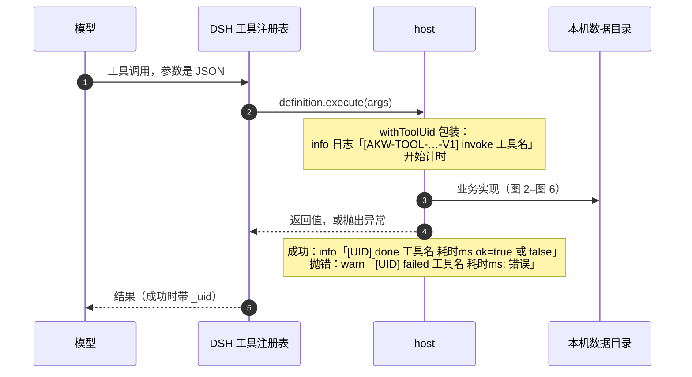
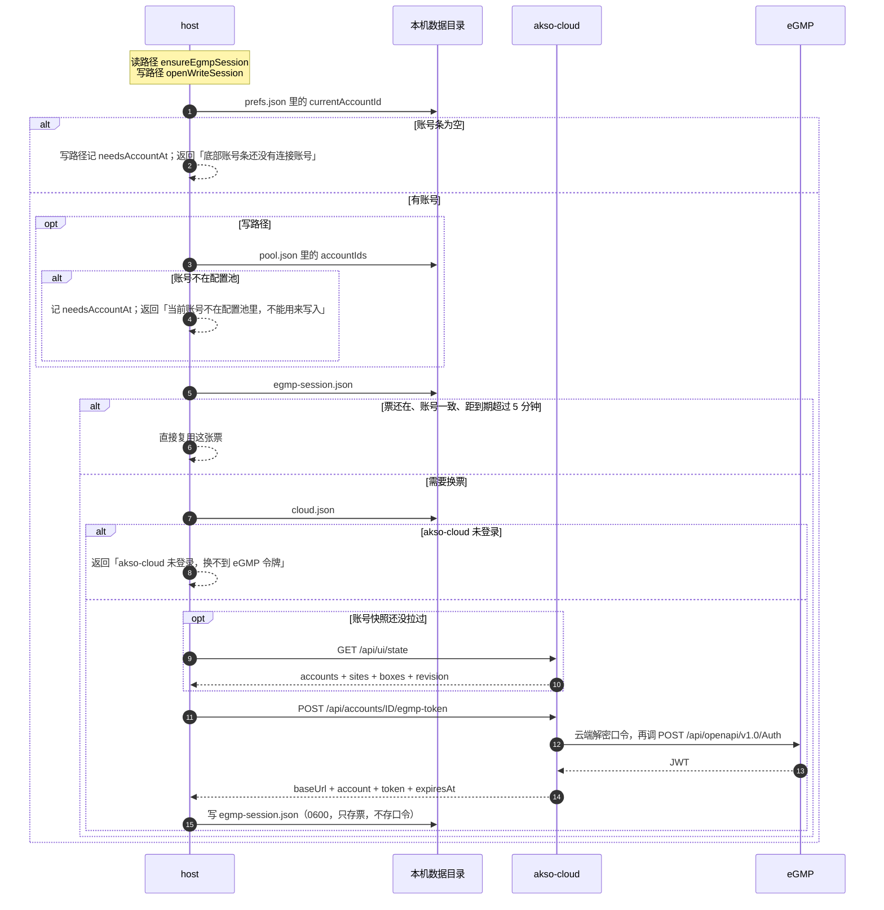
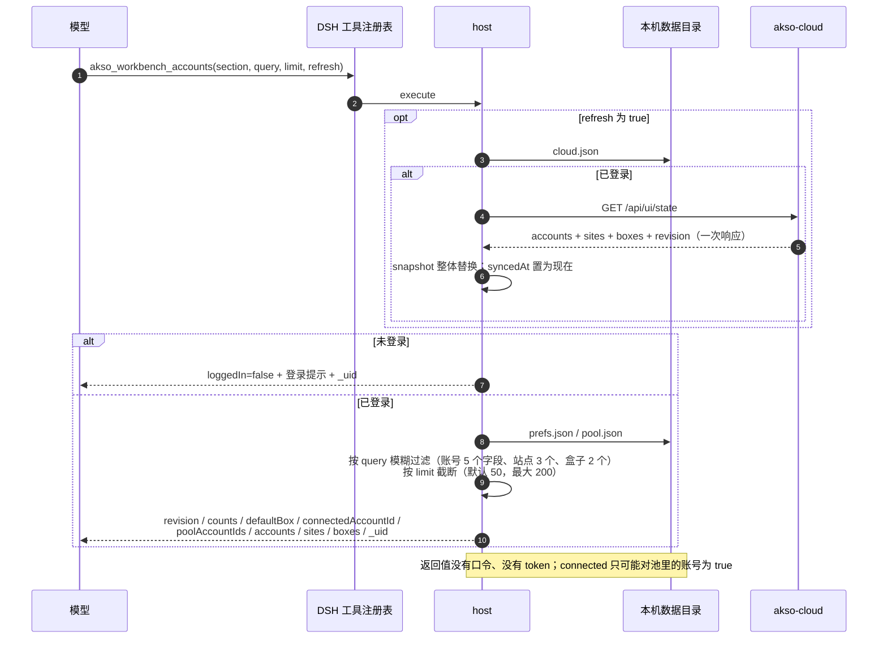
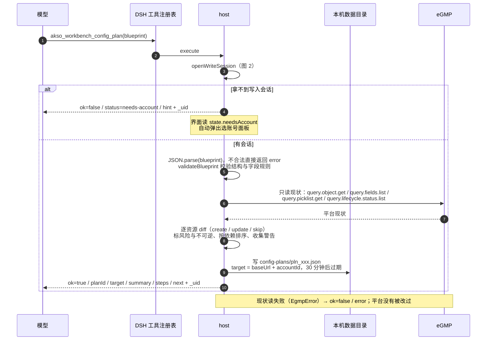
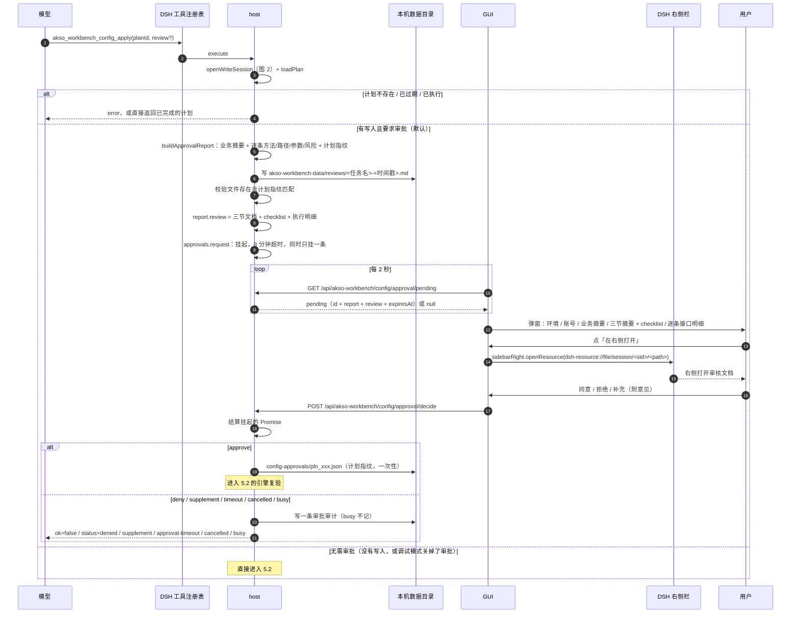
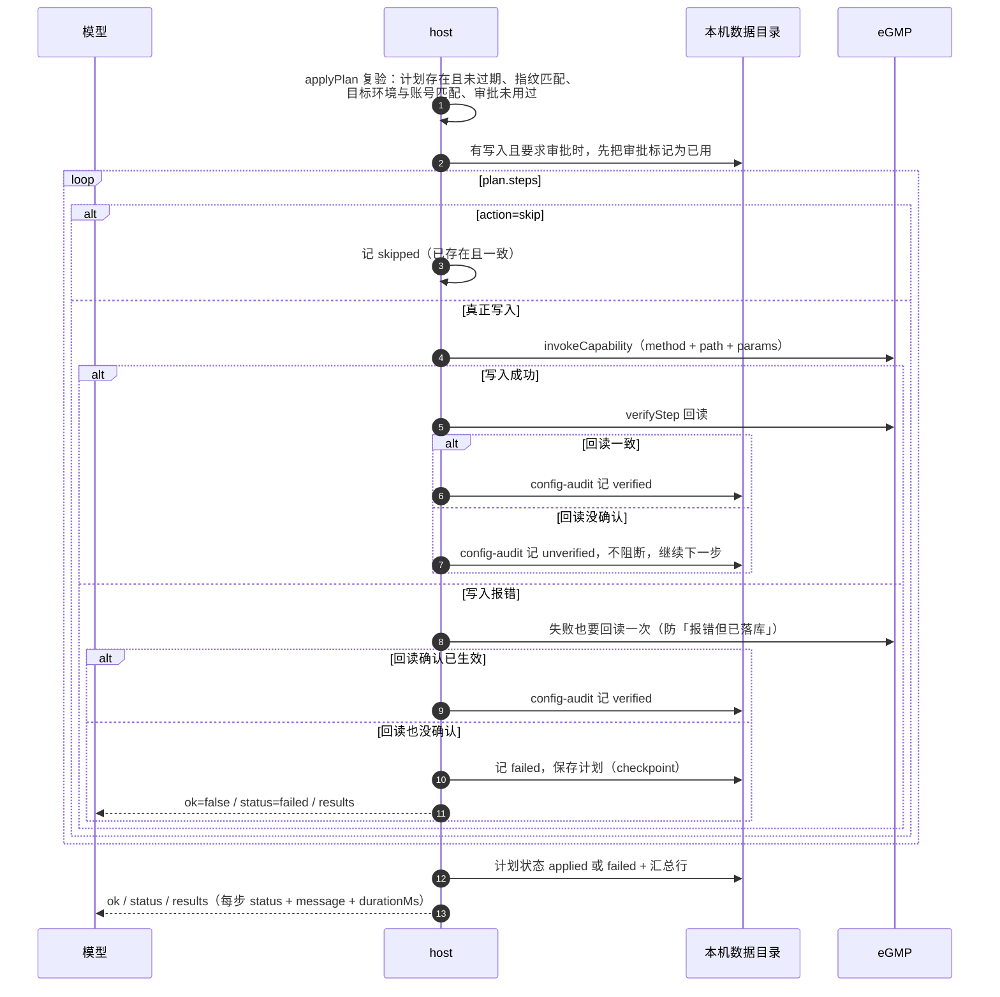
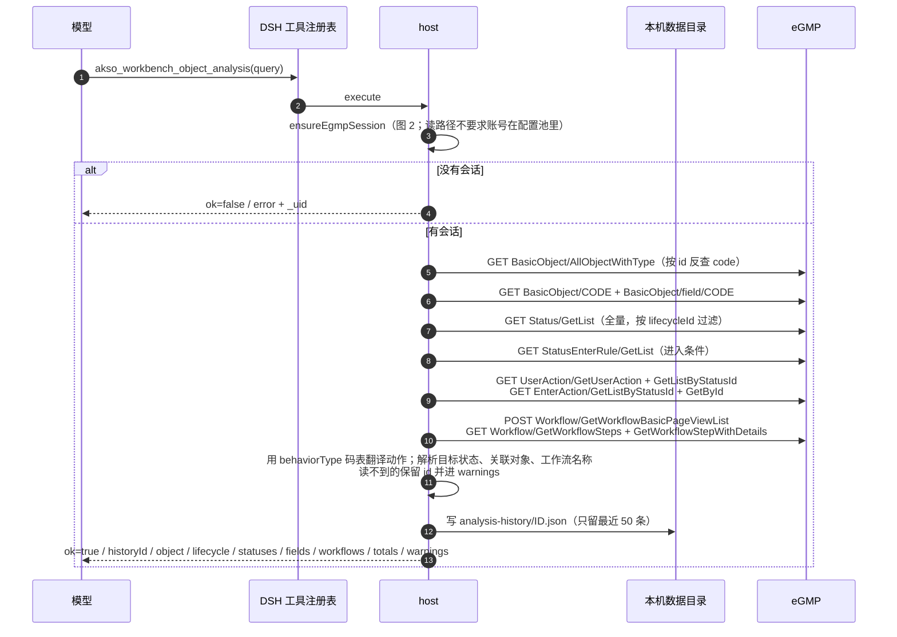
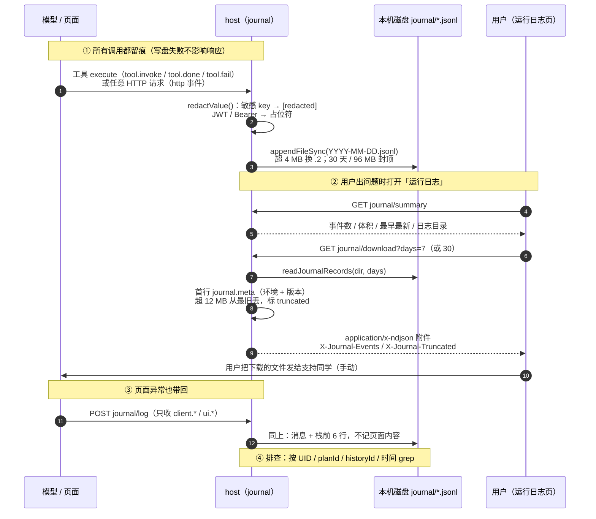

# agent 调用 akso-workbench 的时序

> 这张图回答三个问题：模型调一次工具，本机到底做了哪些事；哪一步会碰 akso-cloud / eGMP；
> 哪一步需要人点一下。排查时先看图，再按 `_uid` 找日志，最后才翻代码。

图用 Mermaid 写。GitHub、带 Mermaid 插件的 VS Code、以及支持 Mermaid 的 Markdown 预览都能直接渲染；
渲染不出来时，代码块本身也按「谁 → 谁、做了什么」可读；看不了 Mermaid 的，§11 有渲染好的 PNG。
改工具流程时**同一提交里改这篇**。

**目录**

1. [一次工具调用的外壳](#1-一次工具调用的外壳)
2. [公共前置：账号门与换票](#2-公共前置账号门与换票)
3. [`akso_workbench_accounts`：读快照](#3-akso_workbench_accounts读快照)
4. [`akso_workbench_config_plan`：只出计划](#4-akso_workbench_config_plan只出计划)
5. [`akso_workbench_config_apply`：审批 → 执行](#5-akso_workbench_config_apply审批--执行)
6. [`akso_workbench_object_analysis`：只读分析](#6-akso_workbench_object_analysis只读分析)
7. [出错时怎么对号](#7-出错时怎么对号)
8. [排查一次调用](#8-排查一次调用)
9. [与代码的对应](#9-与代码的对应)
10. [什么时候要改这篇](#10-什么时候要改这篇)
11. [渲染版（PNG）](#11-渲染版png)

## 参与者

| 参与者 | 是谁 | 关键事实 |
|---|---|---|
| 模型（agent） | DSH 里的模型 | 只看得到工具 description 与返回值，看不到 token |
| DSH 工具注册表 | `ctx.tools.register` | 调 `definition.execute(args)`，把结果交回模型 |
| host | 插件的 node 半边（`plugin/src/index.ts`） | 唯一持有 eGMP token 的地方；围栏只放行本机 |
| 本机数据目录 | `<dshHome>/akso-workbench/` | `cloud.json` / `prefs.json` / `pool.json` / `egmp-session.json` / `config-plans/` / `config-approvals/` / `config-audit/` / `analysis-history/` |
| GUI | 浏览器里的插件页面 | 底部账号条、对话里的审批窗；只读 host 的 HTTP 接口 |
| akso-cloud | 云端账号库 | 存口令、代登录 eGMP、提供 `/api/ui/state` 快照 |
| eGMP | 客户平台 | 所有配置读写的最终落点 |

三条不变式（图里会反复出现它们的原因）：

1. **令牌不下发**：`egmp-session.json` 只在 host 里读写，HTTP 响应与工具返回值都不含 token；
   浏览器只拿「已登录 + 环境 + 账号名」。
2. **一份快照喂所有座位**：账号条、账号中心、`akso_workbench_accounts` 读的是 host 里**同一个**
   `snapshot` 变量；任何写操作都走 `cloud op → sync → 返回整份新快照`，不做本地先改。
3. **写要过三道门**：账号门（账号条 + 配置池）→ 审批门（人点「同意」）→ 引擎复验（计划指纹、
   目标环境、账号、审批记录）。三道门都在 host，**都不在工具参数里**。

## 1. 一次工具调用的外壳

四个工具都经 `withToolUid()` 注册（`plugin/src/tool-uids.ts`）。包装层只做三件事：给 description
追加 UID、开始/结束打日志、给返回值注入 `_uid`。业务结果（拒批、缺账号等）用返回值表达，
**不抛异常**，所以 `done` 里要同时看 `ok=`；真正抛异常才会出现 `failed`。



四个工具的 UID：

| 工具 | UID |
|---|---|
| `akso_workbench_accounts` | `AKW-TOOL-ACCOUNTS-V1` |
| `akso_workbench_config_plan` | `AKW-TOOL-CONFIG-PLAN-V1` |
| `akso_workbench_config_apply` | `AKW-TOOL-CONFIG-APPLY-V1` |
| `akso_workbench_object_analysis` | `AKW-TOOL-OBJECT-ANALYSIS-V1` |

## 2. 公共前置：账号门与换票

`config_plan`、`config_apply` 走**写路径** `openWriteSession()`：账号必须来自底部账号条
（`prefs.currentAccountId`）**且在配置池**（`pool.json`）。`object_analysis` 与能力查询走**读路径**
`ensureEgmpSession()`：只要求账号条不为空，不要求在池里。两者都不回落到磁盘上的旧会话。

账号条为空、账号不在池、或换不到票时，写路径会把 `needsAccountAt` 置为当前时间；界面看到
`state.needsAccount = true`（5 分钟内有效）就自动弹出选账号面板。



`REFRESH_MARGIN_MS = 5 * 60 * 1000`：票离到期不到 5 分钟就提前换，避免写到一半 401。

## 3. `akso_workbench_accounts`：读快照

只读，**不碰 eGMP**；`refresh:true` 时先向 akso-cloud 回拉一次。快照是 host 里的一个变量，
所以界面和工具看到的是同一份数据、同一个 `revision`。



## 4. `akso_workbench_config_plan`：只出计划

计划阶段**一个写请求都不发**。产出一份 `config-plans/pln_*.json`：目标环境 + 账号、逐资源
create/update/skip、风险与不可逆标记、依赖顺序、警告、30 分钟后过期。计划文件是后续 apply
唯一的输入；工具参数里没有「顺便改一下」的位置。



`next` 会明确告诉模型：有几步不可逆、要让用户确认后用哪个 `planId` 调 apply。

## 5. `akso_workbench_config_apply`：审批 → 执行

这个工具分两段：**审批**（有人参与）和**执行**（引擎逐步写、逐步回读）。审批关掉时
（调试模式的页面开关 / 环境变量）直接从执行开始，但引擎仍要求计划绑定了目标环境与账号。

### 5.1 审批：人点「同意」才往下走

审批门在 host 内存里（`plugin/src/config/approval.ts`）：同一时间只挂一条；等待上限 8 分钟；
工具被中断会结算成 `cancelled`。浏览器每 2 秒轮询 `pending`，弹窗里**没有 ×**——只能显式选同意、
拒绝或补充。

审批前 host 会先写一份审核文档（`plugin/src/config/approval-review.ts`）：
优先写到 `<当前工作区>/akso-workbench-data/reviews/<任务名>-YYYYMMDD-HHmmss.md`（`review.workspaceDir`
优先，其次 `exec` 提供的工作区根；两者都没有时返回 `review-unavailable`，不回落 profile 或仓库内目录），内容为「问题 / 执行计划 / 预期结果 checklist」，并附
计划指纹与逐条执行明细（方法/路径/参数），保证审核文件与实际工具输入一致。
任务已执行后的局部优化/更新用 `update` 类型，写到 `<任务名>-更新-YYYYMMDD-HHmmss.md`，篇幅更短，
只含任务概述 / 调整计划 / 预期 checklist / 本次操作清单，可带 `previousReviewPath` 与 `reason`。
报告里带 `review.path`、`review.kind` 与 `review.url`；弹窗展示任务概述、文档地址与「在右侧打开」，
通过 `ctx.sidebarRight.openResource` 在 DSH 右侧文件预览打开；弹窗常驻「调整内容」文本框，填写后只能
「提交调整」，空内容时只能「同意」。`config_apply` 可传
`review{kind,taskName,previousReviewPath,problem,approach,expected[],reason,workspaceDir}` 覆盖自动
生成的内容；审批前会校验文档存在、类型匹配且计划指纹匹配，不匹配或写失败返回
`review-unavailable`，不进入审批。
两步审批：先 `prepareOnly:true` 只生成文档并返回 `status:'prepared'` + 路径/URL（不弹窗、不写平台），
模型把目标和文件链接发给用户；之后用 `reviewPath` 再调用，复用同一份文档进入审批，不会重新生成。
任务成功后 host 才把文档标记为「已结束（审核文件作废，仅作历史记录）」并附执行结果；拒批 / 超时 /
失败不作废。**已结束文档禁止再修改**，后续调整必须新建 `update` 文档。



### 5.2 执行：引擎复验 + 逐步回读

引擎（`plugin/src/config/engine.ts` 的 `applyPlan`）不信任工具：计划指纹、目标 `baseUrl`、
`accountId`、审批记录未用过，全部再验一遍；通过后先把审批标记为已用，**中途失败也不能拿同一张
审批重试**。每一步写完后都回读校验，但停不停分两种情况：**写入报错且回读也没确认**才停（返回
checkpoint）；**写成功但回读没确认**记 `unverified`，继续后面的步骤。



两个容易误判的细节：

- 平台存在「HTTP 200 + `code=401`，但数据已经落库」的端点（实测 `picklist.save`）。所以**写报错
  也要回读一次**：回读确认已生效就记 `verified`，否则记 `failed` 并停，避免模型重试把数据写两遍。
- 结果里的 `unverified` 表示「写请求没报错，但回读没确认」，不等于没写；它**不阻断**后续步骤，
  计划整体仍可能是 `applied`，要人工核对这一步。

## 6. `akso_workbench_object_analysis`：只读分析

读路径换票（图 2）之后，把「对象 → 生命周期 → 状态 → 动作 → 工作流」一次性读成模型；只读，
**不写平台**。局部接口失败只进 `warnings`，不猜、不编。每次调用都落一条分析历史（失败也落，带
错误原因与发起时的环境/账号），页面与工具共用同一份历史。



查询参数是对象 id（UUID）或 code（如 `homework2__c`）；返回里的 `source` 带上本次实际用的
`baseUrl` 与 `account`，报告/流程图必须把它写进去，避免和环境判断混在一起。

## 7. 运行日志：一次调用留了什么、怎么带走

DSH 的宿主日志（`ctx.logger`）只在开发机控制台里，**用户拿不到**，所以「别的同事用出问题」时
我们手里什么都没有。运行日志（journal）补的就是这一段：host 把工具调用、HTTP、业务动作与页面异常
写成 JSONL，页面上给一个「下载日志」按钮，用户把文件发回来即可复盘。它**不替代**审计与审批记录
（那两类仍是写入口径），只是给支持用的使用轨迹。



**记哪些事件**（`kind` 字段）：

| 事件 | 何时 | 关键字段 |
|---|---|---|
| `tool.invoke` / `tool.done` / `tool.fail` | 每次工具调用 | `tool`、`uid`、`ms`、`ok`、参数与结果的摘要 |
| `http` | 每条本机 API 请求 | `method`、`path`、`status`、`ms` |
| `cloud.login` / `cloud.logout` / `cloud.sync` / `cloud.device.*` | 云端账号动作 | `email`（打码）、`revision`、`ok` |
| `egmp.token.mint` / `egmp.needs-account` / `egmp.logout` | 换票与账号门 | `accountId`、`baseUrl`、`refreshed` |
| `approval.wait` / `decide` / `timeout` / `cancelled` / `busy` | 审批窗 | `planId`、`verdict`、`waitedMs` |
| `plan.created` / `apply.run` | 计划与执行 | `planId`、`status`、`steps`、`failed`、`verified` |
| `analysis.run` | 对象分析（工具与页面共用） | `query`、`object`、`baseUrl`、`fields`、`warnings`、`ms` |
| `error.api` / `error.tools` | 路由与工具抛错 | `message`、`code`、`traceId`、`path` |
| `client.*` / `ui.*` | 页面请求与操作、`ui.error` | `path`、`message`、`stack`（前 6 行） |
| `app.start` | host 装载插件 | `plugin`、`node`、`platform`、`routes`、`dshHome` |

**边界**：保留 30 天；单文件 4 MB、每天最多 5 个；总量 96 MB；单次导出 12 MB（超出从最旧丢）。
写盘前统一打码：敏感 key（password/token/secret/authorization…）→ `[redacted]`，JWT/Bearer → 占位符；
**不写请求体原文**。日志写不进去会在 `journal.record` 内部吞掉——宁可少一条，也不能让工具调用失败。

**怎么读**：下载文件是 NDJSON，第一行 `kind: "journal.meta"`（format/version/days/events/插件版本/DSH_HOME/Node/系统），
其余每行一条记录，按 `ts` 升序。常用查法：`grep '"kind":"tool.invoke"'` 看模型调了什么；
`grep '"planId":"pln_'` 追一张计划的审批与执行；`grep '"historyId"'` 找某次分析的产物；先看 `ui.error` 再看时间相邻的 `http`。

页面路径：一级导航 **运行日志** → 概览（事件数/体积/时间范围/目录）→「下载 7 天」「下载 30 天」，
另可「复制日志目录」直接到资源管理器里翻原始文件。

## 8. 出错时怎么对号

| 返回 / 错误 | 什么时候出现 | 平台是否被写过 | 下一步 |
|---|---|---|---|
| `status: needs-account` | 账号条为空、账号不在配置池、换不到票 | 没有 | 账号条连接账号（或让用户点「添加账号」）后重试 |
| `status: busy` | 已有一条审批在等回复 | 没有 | 先处理屏幕上那条审批 |
| `status: denied` | 人点了「拒绝」 | 没有 | 问用户原因，改蓝图重新出计划 |
| `status: supplement` | 人点了「补充」，`note` 是意见 | 没有 | 按 `note` 改蓝图，重新 plan 后重新审批 |
| `status: approval-timeout` | 审批窗 8 分钟没人回应 | 没有 | 重新调用 apply，会重新弹窗 |
| `status: cancelled` | 工具调用被中断（没有收到同意） | 没有 | 重新调用 apply |
| 「这个计划还没有经过人工审批」 | 计划没有审批记录（绕过工具直调引擎） | 没有 | 走工具，在弹窗里点同意 |
| 「审批记录与计划内容不一致」 | 审批指纹与计划文件不一致（计划被改过） | 没有 | 重新 plan，重新审批 |
| 「这个计划的审批已经用过了」 | 这张审批已经被消费过 | 没有 | 重新 plan，重新审批 |
| 「这个计划没有记录目标环境与账号」 | 旧计划没有 `target` | 没有 | 重新 plan |
| 「计划的目标环境与当前会话不一致」或「计划绑定的账号与当前账号不一致」 | 计划 target 与当前会话不符 | 没有 | 换回计划绑定的账号，或重新 plan |
| 「这个计划没有绑定账号」 | 计划没有 `accountId` | 没有 | 账号条选好账号后重新 plan |
| 「计划已过期（30 分钟）」 | plan 太久没执行 | 没有 | 重新 plan |
| `status: failed` | 某步写入报错且回读也没确认，已停 | **可能写过**（前面的步骤） | 看 `results` 与 audit；不要重跑同一计划，重新 plan |
| 每步 `unverified` | 写请求没报错，但回读没确认 | 可能已写 | 人工回读核对；它不阻断后续步骤，计划仍可能 `applied` |

> 表里引号中的中文是工具返回的 `error` 文本；对应的英文 code（`APPROVAL_REQUIRED`、
> `TARGET_CHANGED` 等）是引擎内部的 `EgmpError.code`，不随工具返回，排查时按中文文本 grep。

HTTP 直调（页面/调试口）也过同一套门：`POST /api/akso-workbench/config/invoke` 的写类能力
默认 403（`AKSO_WORKBENCH_ALLOW_DIRECT_WRITE=1` 仅本机调试），`POST .../config/apply` 同理；
只读但用 POST 的查询（`readonly: true`）放行。

## 9. 排查一次调用

按这个顺序，通常三步内能定位：

1. **模型侧**：返回值里的 `_uid` 和工具列表 description 末尾的 `UID: …` 对上，确认调的是哪个工具。
2. **host 日志**：`grep "[AKW-TOOL-CONFIG-APPLY-V1]"`，看 `invoke` / `done ok=` / `failed`；
   `done` 的耗时能区分「卡在审批」还是「卡在平台」。
3. **落盘文件**（都在 `<dshHome>/akso-workbench/`）：
   - `config-plans/pln_*.json`：计划原文（含 `target`、`hash` 输入、每步 `params`）
   - `config-approvals/pln_*.json`：`hash`、`at`、`usedAt`（有 `usedAt` = 已消费）
   - `config-audit/`：`<YYYY-MM>.jsonl` 每步一条（`status` / `traceId` / `durationMs`），
     `approvals-<YYYY-MM>.jsonl` 审批决策一条
   - `akso-workbench-data/reviews/<任务名>-<YYYYMMDD-HHmmss>.md`：创建/调整任务的审核文档（工作区下，不入库）；
     任务成功后状态改为「已结束（审核文件作废）」并附执行结果；已结束文档不可再改
   - `akso-workbench-data/reviews/<任务名>-更新-<YYYYMMDD-HHmmss>.md`：已执行任务的小范围更新文档，
     篇幅更短，带关联的已执行文件与调整原因
   - `analysis-history/<id>.json`：分析结果全文
   - `egmp-session.json`：只有票与来源账号，没有口令

审批窗不出现时：先看 host 是否在跑（`configApprovalPending` 每 2 秒轮询，失败只打 `console.debug`），
再看 `state.needsAccount` 是否把界面引到选账号面板了——没有账号时计划根本不会生成，也就没有审批。

## 10. 与代码的对应

| 文件 | 职责 |
|---|---|
| `plugin/src/tool-uids.ts` | UID 登记、`withToolUid()` 包装（日志 / `_uid` / 未登记抛错） |
| `plugin/src/tool.ts` | `akso_workbench_accounts` 的实现与返回字段裁剪 |
| `plugin/src/config/tools.ts` | `config_plan` / `config_apply` 工具；审批报告与业务摘要 |
| `plugin/src/config/engine.ts` | 读现状、diff、计划文件、`applyPlan` 复验、逐步执行与回读、审计 |
| `plugin/src/config/approval.ts` | 审批门：单条、8 分钟超时、abort 结算 |
| `plugin/src/config/approval-review.ts` | 生成 `create` / `update` 两类审核文档、计划指纹校验、任务结束作废；已结束文档禁止再改，更新另起新文件 |
| `plugin/src/index.ts` | HTTP 路由、`snapshot`、`ensureEgmpSession` / `openWriteSession`、工具注册 |
| `plugin/src/analysis-tool.ts` | `object_analysis` 工具外壳与返回裁剪 |
| `plugin/src/analysis.ts` | 对象/状态/动作/工作流的只读读取 |
| `plugin/src/analysis-history.ts` | 分析历史（最多 50 条） |
| `plugin/src/client/strip.tsx` | 审批窗：2 秒轮询、同意/拒绝/补充 |
| `plugin/src/journal.ts` | 运行日志：打码、切天、轮转、保留期、导出 |
| `plugin/src/client/logs.tsx` | 页面「运行日志」：概览 + 下载 7/30 天 |
| `plugin/src/cloud.ts` | akso-cloud HTTP（`/api/ui/state`、`/api/accounts/:id/egmp-token` 等） |
| `plugin/src/credentials.ts` | 凭据来源：云端代登录，口令不出云端 |

## 11. 什么时候要改这篇

- 新增/改名/删除工具：先登记 UID（`plugin/src/tool-uids.ts`），再补一张图和 §1 的表。
- 改审批判定（新增 verdict、改超时、改「一次只挂一条」）：改 5.1 与 §8。
- 改会话来源（不再只认账号条、换票端点变化）：改 §2。
- 新增会写平台的路径（新工具、新 HTTP 直调口）：补图，并确认它过 `applyPlan` 的同一道门。
- 新增落盘文件：补 §9。
- 新增/改运行日志事件（`recordEvent`、`track`、新路由）：改 §7 的事件表与图 8，并同步 `docs/knowledge/日志与排查.md`。
- 改完图重渲染 §12 的 PNG，否则图片会和 Mermaid 源码对不上。

## 12. 渲染版（PNG）

**Mermaid 源码是唯一事实来源**；PNG 只是渲染快照，给不方便渲染 Mermaid 的场合（邮件、PPT、聊天）
用。改图先改上面的代码块，再重渲染，不要把 PNG 当成源文件手改。

| 图 | 文件 |
|---|---|
| 1 一次工具调用的外壳 | [fig-1.png](diagrams/agent-flows/fig-1.png) |
| 2 公共前置：账号门与换票 | [fig-2.png](diagrams/agent-flows/fig-2.png) |
| 3 `akso_workbench_accounts`：读快照 | [fig-3.png](diagrams/agent-flows/fig-3.png) |
| 4 `akso_workbench_config_plan`：只出计划 | [fig-4.png](diagrams/agent-flows/fig-4.png) |
| 5 `akso_workbench_config_apply`：审批 | [fig-5.png](diagrams/agent-flows/fig-5.png) |
| 6 `akso_workbench_config_apply`：引擎执行 | [fig-6.png](diagrams/agent-flows/fig-6.png) |
| 7 `akso_workbench_object_analysis`：只读分析 | [fig-7.png](diagrams/agent-flows/fig-7.png) |
| 8 运行日志：留痕 → 概览 → 下载 | [fig-8.png](diagrams/agent-flows/fig-8.png) |

重渲染（仓库根目录，需要本机有 Chrome；`mmdc` 会把每个 Mermaid 块输出成 `fig-1`…`fig-8`）：

```powershell
npx -y @mermaid-js/mermaid-cli -i docs/knowledge/agent调用时序.md -o docs/knowledge/diagrams/agent-flows/fig.png
```

下载不到 Chromium 的环境，加 `-p puppeteer.json` 指向本机 Chrome（文件内容：
`{"executablePath":"C:\\Program Files\\Google\\Chrome\\Application\\chrome.exe","args":["--no-sandbox"]}`）。
